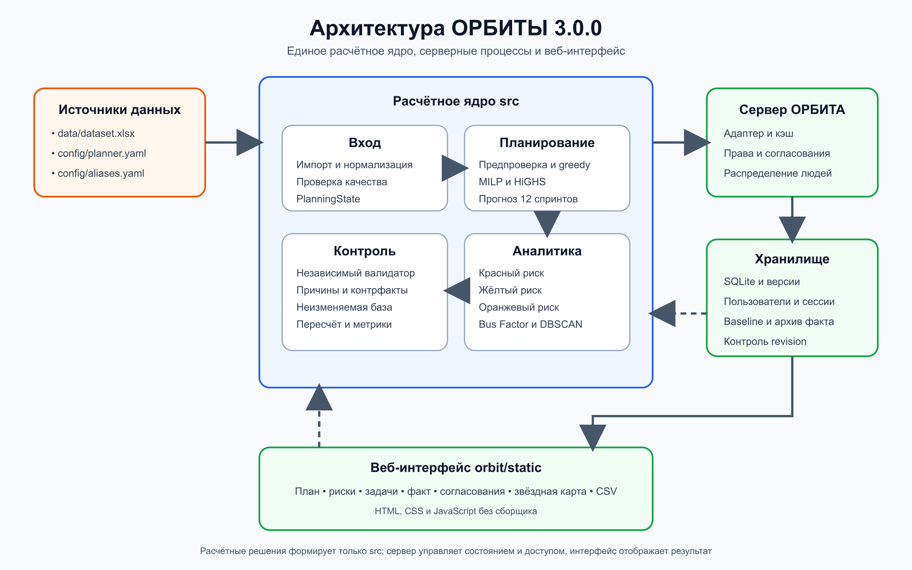

# ОРБИТА

## Полная документация проекта квартального планирования и звёздной карты

Версия продукта: 3.0.0  
Версия документа: 1.0  
Дата документа: 22 сентября 2026 года  
Статус: реализовано и проверено автоматическими тестами; ручная приёмка полного пользовательского сценария остаётся открытой

## 1 Назначение документа

Документ описывает итоговую систему ОРБИТА после объединения расчётного ядра `src/` с сервером и интерфейсом `orbit/`. Он предназначен для разработчиков, тестировщиков, владельца установки, руководителей команд и лиц, принимающих решение о приёмке проекта.

Документация фиксирует назначение продукта, требования, архитектуру, правила обработки данных, алгоритмы планирования, пользовательские процессы, API, безопасность, запуск, тестирование, ограничения и состав выполненных работ. Расчётные правила приведены по актуальному ядру. Материалы ОРБИТЫ 2.0.2 используются только там, где они описывают интерфейс, роли пользователей, серверные процессы и эксплуатацию.

## 2 Краткое описание результата

ОРБИТА — локальный веб-сервис для квартального планирования работы шести команд и анализа рисков компетенций. Сервис строит план на шесть двухнедельных спринтов, продолжает прогноз до двенадцатого спринта, принимает фактические результаты каждые две недели и пересчитывает оставшуюся часть квартала относительно неизменяемой исходной базы.

В итоговой версии расчётное ядро является единственным источником планов, метрик и рисков. Сервер ОРБИТА отвечает за учётные записи, права, согласования, хранение версий, ввод факта, распределение рассчитанных ролевых часов между людьми и пользовательский интерфейс.

Основные результаты:

- точный планировщик на целочисленной линейной модели MILP с решателем HiGHS;
- жадный план по тем же правилам как база сравнения и резервный результат;
- независимая проверка каждого построенного плана;
- объяснения переноса и отмены работ, а также контрфактический анализ;
- пересчёт после факта со стабильностью относительно предыдущего плана;
- неизменяемая исходная база для расчёта квартальных и спринтовых показателей;
- красные, жёлтые и оранжевые предупреждения о рисках;
- звёздная карта, Bus Factor и поиск уникальных профилей инженеров;
- разграничение прав, регистрация по приглашениям и согласование межкомандных изменений;
- импорт факта и экспорт отчёта в CSV;
- единые датасет, конфигурация, зависимости и документация для ядра и сервера.

На актуальном интегрированном состоянии официального датасета план завершает в квартале 34 из 37 открытых задач и 14 из 15 инициатив. Жадный план при тех же условиях завершает 12 инициатив. Первый точный расчёт занимает обычно 13–20 секунд, после изменений состава может занимать до 35 секунд; повторный расчёт идентичных условий берётся из кэша за доли секунды.

## 3 Бизнес задача

Руководителям команд, ресурсным менеджерам и ИТ-директору необходимо заранее понимать, какой объём работ реально завершится за квартал. Суммы Story Points недостаточно: выполнимость зависит от фактической производительности команд, фонда времени инженеров, доступности ролей и технологий, межкомандной занятости и графа зависимостей.

Отклонение одного спринта может сдвинуть связанную цепочку задач и поставить под угрозу инициативу. Отдельный риск возникает, когда критической компетенцией владеет один человек. ОРБИТА объединяет квартальный план, пересчёт по факту и карту компетенций, чтобы показать не только прогнозный срок, но и причины решения.

### 3.1 Цели продукта

Система должна:

1. построить выполнимый план на 12 недель;
2. выбрать приоритетные инициативы при дефиците ресурсов;
3. объяснить включение, перенос или отмену каждой работы;
4. после каждого спринта обновить прогноз без изменения исходной базы сравнения;
5. показать риск выхода за квартал, каскадный сдвиг и дефицит ролей;
6. рассчитать показатели выполнения спринта и квартала;
7. показать состав команд, компетенции, доступность и Bus Factor;
8. обеспечить работу глав команд и сотрудников с различными правами.

### 3.2 Границы решения

В систему входят импорт официального Excel-файла, планирование, пересчёт, управление задачами и людьми, согласования, факт спринта, отчёт CSV, карта компетенций, локальный HTTP-сервер и веб-интерфейс.

В систему не входят интеграции с внешними трекерами, корпоративная рассылка приглашений, самостоятельный сброс пароля, распределённый запуск нескольких серверов, готовая публичная публикация в интернет и автоматическое управление Windows ACL.

## 4 Соответствие требованиям задачи

| Требование | Реализация | Статус |
|---|---|---|
| Квартал из шести двухнедельных спринтов | Длина квартала задаётся `quarter_sprints = 6`; прогноз строится до 12 спринтов | Выполнено |
| Ёмкость команды по истории с коэффициентом 0,8 | Средняя фактическая производительность умножается на `focus_factor = 0.8` | Выполнено |
| 80 часов на полную ставку и 40 часов на 0,5 ставки | Фонд рассчитывается как `80 × capacity_rate` по каждому спринту | Выполнено |
| Одновременный учёт SP и часов ролей | Ограничения независимы и связаны общей долей прогресса задачи | Выполнено |
| Технологическое соответствие | Сервер формирует производные роли с требуемым стеком; назначаются только подходящие люди | Выполнено |
| Зависимости между задачами | Направленный граф, разные зазоры после планового и фактического завершения | Выполнено |
| Объяснения решений | Причины по задачам и инициативам, загрузка ограничений и контрфакты | Выполнено |
| Пересчёт раз в спринт | Факт шести команд закрывает спринт и запускает пересчёт остатка | Выполнено |
| Красный, жёлтый и оранжевый алерты | Рассчитываются ядром по готовому плану и сравнению с базой | Выполнено |
| PI Predictability и Sprint Say Do | Квартальные и спринтовые показатели считаются относительно неизменяемой базы | Выполнено |
| Звёздная карта и Bus Factor | Карта команд и сотрудников, Bus Factor по навыкам, уникальные профили DBSCAN | Выполнено |
| Работающий интерфейс | Русскоязычный интерфейс для главы и сотрудника, светлая и тёмная темы | Выполнено автоматическими проверками; полная ручная приёмка открыта |
| Воспроизводимый запуск | Один `requirements.txt`, общий конфиг, скрипты запуска и Dockerfile | Выполнено |

## 5 Пользователи и права

### 5.1 Роли

В системе две пользовательские роли.

**Глава команды** управляет своей командой, видит организационный план, риски и звёздную карту. Глава может изменять задачи своей команды, приглашать сотрудников, подтверждать факт и участвовать в согласованиях. Пересчёт всей организации требует отдельного права `org_replan`.

**Сотрудник** видит свои команды, личные назначения и доступный ему план. Он не меняет задачи, состав команды, согласования и факт. При согласованной помощи сотрудник может видеть назначенную ему работу другой команды.

### 5.2 Матрица доступа

| Операция | Сотрудник | Глава команды |
|---|---|---|
| Просмотр задач и назначений | Свои команды и личные назначения | Все команды |
| Изменение задачи и исполнителей | Нет | Своя команда |
| Добавление задачи или сотрудника | Нет | Своя команда |
| Приглашение пользователя | Нет | Сотрудники своей команды |
| Передача, обмен, помощь часами | Нет | После согласия двух глав |
| Фиксация исходного плана | Нет | Голос зарегистрированной главы |
| Подтверждение факта | Нет | Своя команда |
| Пересчёт всей организации | Нет | Только с `org_replan` |
| Звёздная карта и риски компетенций | Нет | Вся организация |
| Экспорт CSV | Доступные задачи | Все задачи |

Права проверяются сервером. Скрытие кнопок в интерфейсе не считается средством авторизации.

## 6 Архитектура

### 6.1 Компоненты

| Компонент | Назначение |
|---|---|
| `src/` | Импорт, нормализация, валидация, ресурсы, MILP, жадный план, объяснения, пересчёт, метрики, риски, звёздная карта |
| `orbit/app.py` | HTTP-маршруты, статика, cookie, CSRF, ограничения запросов и команды администратора установки |
| `orbit/planner/bridge.py` | Преобразование серверного состояния в структуры ядра |
| `orbit/planner/present.py` | Вызов ядра, кэширование, преобразование результата в модель интерфейса |
| `orbit/planner/flow.py` | Распределение ролевых часов между конкретными инженерами |
| `orbit/planner/team_service.py` | Права команд, ручные действия, согласования, факт и CSV |
| `orbit/planner/store.py` | SQLite, версии состояния и оптимистическая блокировка |
| `orbit/planner/auth.py` | Учётные записи, приглашения, пароли, сессии и лимит входа |
| `orbit/static/` | HTML, CSS и JavaScript без этапа сборки |
| `config/` | Правила планировщика и алиасы ролей |
| `data/dataset.xlsx` | Единый источник исходных производственных данных |



### 6.2 Поток данных

| Этап | Вход | Обработка | Выход |
|---|---|---|---|
| Импорт | Excel на одном листе | Поиск блоков, нормализация, проверки качества | Объект `Dataset` |
| Подготовка состояния | Dataset, конфиг, изменения интерфейса | Расчёт SP, фондов ролей, доступности и ограничений | `PlanningState` |
| Планирование | `PlanningState`, `SolveConfig` | Предпроверка, жадный план, MILP, прогноз, объяснения | `PlanResult` |
| Проверка | `PlanResult` и исходное состояние | Независимая проверка всех ограничений | Список нарушений |
| Представление | План ядра и состояние сервера | Назначение людей, риски, метрики, сериализация | Ответ `/api/state` |
| Пересчёт | Факт спринта, предыдущий план, baseline | Новый остаток, фиксация прошлого, стабильность | Новая версия прогноза |

### 6.3 Принципы архитектуры

- расчётные правила реализованы в одном месте — в `src/`;
- интерфейс не пересчитывает план самостоятельно;
- любой план проходит независимую проверку;
- состояние сервера хранится версиями, а не перезаписывается без истории;
- все изменяющие запросы используют номер `revision`;
- исходная база после фиксации не меняется;
- одинаковые условия дают воспроизводимый результат;
- сбой точного решателя не останавливает сервис: возвращается жадный план с явным статусом.

## 7 Исходные данные

### 7.1 Состав Excel

Все блоки находятся на листе `Датасет(обновленный)` последовательно. Импортёр ищет их по заголовку, а не по фиксированному номеру строки.

| Блок | Содержимое | Объём актуального набора |
|---|---|---|
| `Tasks` | Задачи, инициативы, команды, статусы, SP, часы и `rung` | 45 задач, 15 инициатив |
| `Estimates` | Матрица часов по ролям и задачам | 258 ненулевых требований |
| `Spent_time_roles` | Фактические часы задач в работе | 24 записи, 602 часа |
| `Task_dependencies` | Направленные связи | 19 связей |
| `Engineers_profiles` | Команды, роли, грейды, навыки и ставка | 34 строки, 30 людей |
| `Team_history` | Историческая производительность | 12 записей |
| Справочники | Цели работ, причины отклонений и результаты закрытия | 8, 5 и 3 значения |

В датасете восемь задач закрыты, шесть находятся в работе и 31 имеет статус ToDo. Совместители представлены несколькими строками, поэтому перед анализом навыков 34 строки сводятся к 30 людям.

### 7.2 Преобразования

- широкая матрица сметы преобразуется в строки `task_id`, `role`, `estimated_hours`;
- строка «Итого по ролям» не считается ролью;
- Excel-даты преобразуются из серийных чисел в календарные даты;
- навыки разбираются по запятым, но запятая внутри скобок не разделяет навык;
- названия ролей нормализуются по `config/aliases.yaml`;
- зависимости читаются по колонкам блокирующей и блокируемой задачи;
- пустые или нечисловые часы приводятся к нулю;
- пустая роль, отсутствующий `task_id` и неполная пара зависимости отбрасываются.

### 7.3 Качество данных

В актуальном наборе валидатор не находит ошибок, препятствующих расчёту, и возвращает 30 предупреждений:

- 24 расхождения между полем общих трудозатрат и суммой часов по ролям;
- 6 ролей, которых нет ни у одного инженера.

Источником трудозатрат служит матрица часов по ролям. Отсутствующая роль не создаётся искусственно. В основном сценарии такая работа допускается как внешняя и одновременно выводится диагностикой и оранжевым риском. Режим строгой блокировки доступен конфигурацией.

## 8 Расчёт ресурсов

### 8.1 Story Points

Доступная ёмкость команды на спринт равна средней фактической производительности по истории, умноженной на 0,8. Коэффициент уже учитывает время на технический долг, дефекты и коммуникации.

Ёмкость команды = средняя фактическая velocity × 0,8.

Story Points не переводятся в часы. Они образуют отдельный предел, который выполняется одновременно с ролевыми ограничениями.

### 8.2 Часы людей и ролей

Фонд сотрудника на двухнедельный спринт равен 80 часам, умноженным на долю занятости. Человек, распределённый между командами или имеющий несколько ролей, учитывается один раз; суммарное использование его времени не может превысить личный предел.

Фонд сотрудника = 80 часов × `capacity_rate`.

Сервер передаёт ядру фонд по каждому спринту. Поэтому отпуск, изменение доступности или согласованная помощь влияют только на соответствующие периоды.

### 8.3 Номинальные ресурсы датасета

| Команда | SP на спринт | SP на квартал | Часы на спринт |
|---|---:|---:|---:|
| Team Alpha | 10,8 | 64,8 | 240 |
| Team Beta | 8,4 | 50,4 | 200 |
| Team Delta | 7,6 | 45,6 | 200 |
| Team K | 12,8 | 76,8 | 360 |
| Team L | 8,0 | 48,0 | 960 |
| Team Platform | 7,2 | 43,2 | 440 |

Для 37 активных задач требуется 240 SP и 5 418 часов. Совокупно доступно 329 SP и 14 400 часов, однако агрегированные суммы скрывают локальные дефициты. Если использовать только специалистов своей команды, 2 371 час обеспечить некому: 1 706 часов доступны в других командах, а 665 часов относятся к ролям, отсутствующим в организации. Поэтому основной сценарий допускает контролируемое межкомандное заимствование.

## 9 Правила планирования

### 9.1 Конфигурация

`InputConfig` задаёт числа, из которых строится состояние: коэффициент фокуса, часы ставки, масштаб ёмкости, способ учёта задач в работе, длину квартала и горизонт прогноза.

`SolveConfig` задаёт правила выбора решения: движок, пул ролей, политику отсутствующих ролей, зазоры зависимостей, минимальную долю работы, раннее завершение и контрфакты.

Полные значения обоих объектов сохраняются в метаданных результата. План можно воспроизвести из тех же данных и конфигурации.

### 9.2 Общая доля прогресса

Для каждой задачи и спринта решатель выбирает долю работы. Одна и та же доля:

- списывает часть SP из ёмкости команды;
- списывает соответствующую часть часов каждой требуемой роли;
- определяет активность, начало и завершение задачи.

Благодаря этому задача крупнее одного спринта растягивается на несколько периодов без искусственного пересчёта SP в часы.

### 9.3 Ограничения модели

Модель контролирует:

1. сумму долей задачи и допустимый остаток;
2. непрерывность работы после начала;
3. не менее 10 процентов задачи в каждом активном спринте;
4. запрет начинать в квартале работу, которая не завершится в квартале;
5. лимит SP каждой команды в каждом спринте;
6. фонд часов каждой роли и общий предел часов людей;
7. дату `not_before`, если её задал руководитель;
8. порядок зависимостей;
9. обязательное продолжение задач InProgress согласно настройке;
10. завершение инициативы только после всех её задач.

Для запланированной блокирующей задачи используется один пустой спринт между работами. Если блокирующая уже имеет фактический статус Done, преемник может начаться в следующем спринте без дополнительного пустого периода.

### 9.4 Предпроверка

До запуска решателя отменяются задачи, которые невозможно выполнить при любом расписании:

- в выбранном пуле нет требуемой роли или подходящего технологического профиля;
- требуемая роль не успеет выполнить объём до конца горизонта;
- блокирующая задача уже отменена.

Отмена распространяется по графу зависимостей. Каждая затронутая задача получает собственную причину.

### 9.5 Лестница целей MILP

Цели решаются последовательно. Результат уровня фиксируется перед переходом к следующему.

| Уровень | Цель |
|---|---|
| 1 | Максимальное число инициатив, завершённых в квартале |
| 2 | При равном числе инициатив максимальная сумма их `rung` |
| 3 | При пересчёте минимальные изменения относительно прошлого плана |
| 4 | Минимум часов, взятых у других команд в пределах квартала |
| 5 | Максимум задач, завершённых в квартале, с дополнительным правилом раннего завершения на сервере |
| 6 | Самое раннее завершение отложенных задач в пределах 12 спринтов |

Первые два критерия объединены безопасным целочисленным весом: одна дополнительная инициатива всегда ценнее любой разницы в `rung`. Аналогично правило раннего завершения объединяется с числом задач так, чтобы не ухудшить более высокий критерий.

Уровни квартала решаются на модели из шести спринтов. Зафиксированное квартальное расписание переносится в модель горизонта из 12 спринтов, где рассчитывается прогноз отложенных работ.

### 9.6 Решатель и повторяемость

Используются PuLP 3.3.2 и HiGHS 1.15.1. Решатель работает в один поток с фиксированными параметрами. Страховочный предел полного расчёта — 120 секунд.

Если точное решение завершилось ошибкой или вышло за предел времени, система возвращает жадный результат со статусом `fallback_greedy` и предупреждением. Пользователь видит, каким движком построен план.

### 9.7 Жадный план

Жадный алгоритм размещает задачи в топологическом порядке и по приоритету инициатив в самый ранний допустимый спринт. Он использует те же фонды, зазоры и ограничения, что и точная модель, а затем проходит тот же валидатор.

Жадный результат нужен для трёх целей:

- резерв при недоступности MILP;
- нижняя граница качества;
- понятная база сравнения эффективности точного планирования.

### 9.8 Независимый валидатор

Валидатор не использует переменные MILP и повторно проверяет готовый результат. Он контролирует полный набор задач, сумму долей, статусы, SP, ролевые часы, общий предел часов, зависимости, инициативы, заимствования и наличие причин. Нарушение не скрывается: список попадает в `validation` результата, а штатный расчёт должен возвращать пустой список.

## 10 Объяснения и контрфакты

Для перенесённой задачи или незавершённой инициативы система формирует причину простым языком. Возможные основания:

- отмена предпроверкой;
- ожидание блокирующей задачи;
- нехватка SP команды;
- нехватка часов конкретной роли;
- отсутствие роли или подходящего исполнителя;
- вытеснение более приоритетной инициативой.

Дополнительно выводятся загрузка команд и ролей, ограничения на 100 процентов, межкомандные заимствования и спрос на следующий спринт.

Контрфакт повторно решает модель с обязательным включением выбранной задачи или инициативы. Он показывает цену решения: какие работы будут вытеснены и как изменится набор квартальных целей. Контрфакты не изменяют основной план. Бюджет ограничен десятью дополнительными решениями и 20 секундами на один пакет анализа; в интерфейсе подробный разбор обычно занимает 20–40 секунд.

## 11 База, факт и пересчёт

### 11.1 Фиксация исходной базы

Исходный квартальный план фиксируется после согласия всех зарегистрированных глав проекта. Если зарегистрирована одна глава, достаточно её голоса. Изменение плана или состава зарегистрированных глав до фиксации делает собранные согласия неактуальными.

Последний голос и сама база сохраняются атомарно. После фиксации база не меняется. План хранится в сериализованном виде, при чтении создаётся новая копия, а перед и после пересчёта сверяется отпечаток.

### 11.2 Факт спринта

Каждая глава подтверждает:

- выполненные SP команды;
- статус каждой незавершённой задачи;
- потраченные часы по ролям;
- при необходимости собственную оценку остатка SP и часов.

Спринт закрывается после действительных подтверждений всех шести команд. Последнее подтверждение объединяет отчёты, обновляет историю производительности, сохраняет архив закрытого спринта и пересчитывает прогноз одной операцией.

### 11.3 Правила остатка

Если глава не указала остаток, он равен предыдущему остатку минус фактические часы, но не меньше нуля. Если расчётные часы исчерпаны, а задача не закрыта, сохраняется минимум 10 процентов сметы. Это предотвращает ложное автоматическое завершение задачи только из-за исчерпания оценки.

Закрытые задачи удаляются из оставшейся модели. Прошедшие спринты фиксируются фактом. Оставшаяся работа пересчитывается с уровнем стабильности, чтобы без необходимости не менять уже согласованное расписание.

### 11.4 Список изменений

Для задач и инициатив отдельно показываются:

- спринт завершения в исходной базе;
- спринт завершения в предыдущем пересчёте;
- новый прогнозный спринт завершения.

Эти данные используются для жёлтого предупреждения и позволяют отличать факт, предыдущий прогноз и новый прогноз.

## 12 Показатели

### 12.1 Выполнение квартального плана

Знаменатель — инициативы, которые исходная база обещала завершить в квартале. Фактический показатель — доля этих инициатив, уже завершённых по факту. Прогнозный показатель рассчитывается отдельно и показывает, сколько целей текущий план всё ещё завершит в квартале.

Выполнение квартала = завершённые базовые инициативы / инициативы исходной базы × 100 процентов.

### 12.2 Выполнение спринта

Плановые SP спринта фиксируются по долям задач в исходной базе. Фактические SP открытой задачи определяются по доле потраченных часов и до закрытия ограничены 90 процентами. При закрытии засчитывается оставшаяся часть.

Выполнение спринта = зачтённые фактические SP / плановые SP исходной базы × 100 процентов.

SP, которые глава указывает вручную как командный результат, сохраняются рядом для сверки и обновляют историю производительности. Они не подменяют зачёт ядра.

## 13 Риски

| Уровень | Условие | Представление |
|---|---|---|
| Красный | Инициатива завершается позже шестого спринта | Инициатива, прогнозный срок и мешающие задачи |
| Жёлтый | После факта задача сдвинулась и потянула зависимую цепочку | Корневая задача и весь затронутый путь |
| Оранжевый | Спрос готовых работ роли на следующий спринт превышает фонд или роль отсутствует | Размер очереди, доступный фонд и выход за квартал |

Риски вычисляются по готовому плану и графу зависимостей. Отдельная упрощённая модель для алертов не используется.

## 14 Звёздная карта

### 14.1 Bus Factor

Bus Factor технологии равен числу разных людей, владеющих этой технологией. Строки совместителя сначала объединяются, чтобы навыки одного человека не учитывались несколько раз.

В исходном расчёте ядра 86 из 116 навыков имели единственного носителя. Актуальный импорт выделяет 117 уникальных записей технологий после нормализации; число зависит от выбранного уровня очистки строк навыков. В интерфейсе значение строится по текущему составу проекта, поэтому добавление сотрудников и изменение их профилей отражаются без отдельного импорта.

Bus Factor 1 означает зависимость от одного сотрудника. Для таких компетенций интерфейс показывает носителя и связанные работы по ролям. Точное соответствие задачи навыку задаётся требованиями в карточке задачи.

### 14.2 Уникальные профили

Инженеры представлены бинарными наборами навыков. Кластеризация DBSCAN использует косинусное расстояние, `eps = 0.3` и `min_samples = 2`. Уникальным считается профиль, у которого нет коллеги с похожестью набора навыков не ниже 0,7.

Bus Factor отвечает на вопрос о замене по одной технологии. DBSCAN показывает, насколько трудно заменить совокупный профиль человека.

### 14.3 Представление карты

Команды показаны крупными узлами, сотрудники — малыми. Связи отражают распределение людей по командам. Узлы можно перемещать мышью, касанием или клавиатурой; фон поддерживает панорамирование. Координаты сохраняются в `localStorage` отдельно от серверных данных.

## 15 Ручное управление и согласования

Глава может изменить приоритет, остаток SP, часы ролей, требуемые навыки, исполнителя и нижнюю границу старта. Перед сохранением кнопка проверки рисков рассчитывает последствия без создания версии.

Передача задачи, обмен двумя задачами и помощь сотрудника часами требуют согласия двух участвующих глав. Создатель заявки даёт первый голос. Вторая сторона может согласовать или отклонить. Третья команда не может принять решение по чужой заявке.

Заявка хранит отпечаток исходных условий и предварительный расчёт. Если состояние изменилось, старое согласие не применяется автоматически: последствия пересчитываются, после чего требуется новое согласие второй стороны. Обмен применяется атомарно. Помощь перераспределяет существующие часы и не увеличивает общий ресурс человека или SP команды.

## 16 Интерфейс

Глава видит разделы «Обзор», «Задачи и спринты», «Звёздная карта», «Факт и пересчёт», «Команда» и «Согласования». Сотруднику доступны «Мои задачи», «План команды» и «Команда».

Обзор главы содержит:

- цветные риски;
- показатели квартала и спринтов;
- ограничения на 100 процентов;
- таблицу заимствований;
- спрос ролей на следующий спринт;
- сравнение точного и жадного движков;
- запуск контрфактического разбора.

Интерфейс поддерживает светлую и тёмную темы. На ширине до 760 пикселей сайдбар располагается над рабочей областью; на ширине 1280 пикселей сохраняется двухколоночная структура. Тексты, формы и ошибки представлены на русском языке.

## 17 HTTP API

### 17.1 Основные маршруты чтения

| Метод и маршрут | Назначение | Доступ |
|---|---|---|
| `GET /api/health` | Состояние сервера и версия | Без входа |
| `GET /api/auth/status` | Названия команд без раскрытия регистрации глав | Без входа |
| `GET /api/auth/me` | Текущий пользователь | После входа |
| `GET /api/state` | Состояние с фильтрацией по роли | После входа |
| `GET /api/report.csv` | Отчёт по доступным задачам | После входа |
| `GET /api/facts/template.csv` | Шаблон факта команды | Глава |

### 17.2 Основные маршруты изменения

| Метод и маршрут | Назначение |
|---|---|
| `POST /api/auth/register` | Регистрация по приглашению |
| `POST /api/auth/login` | Вход, выдача cookie и CSRF |
| `POST /api/auth/logout` | Завершение сессии |
| `POST /api/invitations` | Приглашение сотрудника |
| `POST /api/tasks/update` | Изменение задачи своей команды |
| `POST /api/tasks/add` | Создание задачи |
| `POST /api/employees/add` | Создание сотрудника |
| `POST /api/employees/availability` | Изменение будущей доступности |
| `POST /api/requests/create` | Создание межкомандной заявки |
| `POST /api/requests/decide` | Решение по заявке |
| `POST /api/facts/parse-csv` | Проверка CSV и заполнение формы без сохранения |
| `POST /api/facts` | Подтверждение факта команды |
| `POST /api/approve` | Голос за исходную базу |
| `POST /api/replan` | Организационный пересчёт с правом `org_replan` |
| `POST /api/explain` | Контрфактический разбор |

Изменяющие запросы используют актуальный `revision`. Устаревшее состояние возвращает 409. JSON принимается только с типом `application/json`, включая параметр `charset`; нечисловые значения JSON `NaN` и `Infinity` отклоняются.

### 17.3 Коды ошибок

| Код | Значение |
|---:|---|
| 400 | Неверные данные |
| 401 | Требуется вход или сессия истекла |
| 403 | Нет прав, неверный CSRF или запрещённое происхождение |
| 404 | Маршрут не найден |
| 409 | Конфликт версии или устаревшая операция |
| 413 | Недопустимый размер тела |
| 415 | Неподходящий Content Type |
| 500 | Неожиданная внутренняя ошибка без раскрытия деталей |

## 18 Хранение и целостность

SQLite хранит проекты, полные версии состояния, пользователей, приглашения, сессии и попытки входа. Изменение создаёт новую версию. Клиент передаёт ожидаемый `revision`, а сервер отклоняет устаревшую операцию.

План ядра сохраняется в каждой версии как сжатый JSON без времени расчёта. Это предотвращает ложное изменение отпечатка и позволяет восстанавливать базу, метрики и уровень стабильности.

Изменения одного проекта сериализуются замком проекта; операции чтения замок не берут. Решение рассчитано на один процесс сервера и одну базу SQLite. Распределённая синхронизация не реализована.

## 19 Безопасность

### 19.1 Регистрация и приглашения

При первом запуске создаётся `orbit/var/team_access.txt` с одноразовыми кодами глав. Код главы действует 30 дней. Глава может выдать сотруднику приглашение на 7 дней; повторная выдача отзывает прежний неиспользованный код.

Файл кодов исключён из git. На Linux и macOS он создаётся с правами `0600`; на Windows безопасность зависит от ACL каталога установки.

### 19.2 Пароли и сессии

- логин содержит от 3 до 80 разрешённых символов;
- пароль имеет длину от 10 до 256 символов;
- пароль только из цифр и пароль, совпадающий с логином, запрещены;
- пароли хранятся как scrypt-хэши с индивидуальной солью;
- неизвестный логин проходит сопоставимую операцию хэширования;
- сессия действует 12 часов;
- новый успешный вход отзывает предыдущие сессии пользователя;
- cookie использует `HttpOnly` и `SameSite=Strict`;
- переменная `ORBIT_COOKIE_SECURE=1` добавляет `Secure` за HTTPS-прокси;
- изменяющие запросы проверяют сессию, CSRF и происхождение.

Лимит входа учитывает попытки по IP в окне 15 минут. После 12 попыток следующие отклоняются. Подсчёт и запись выполняются транзакционно.

### 19.3 Экспорт

CSV ограничивается правами текущего пользователя. Текст, который табличный редактор может интерпретировать как формулу, получает безопасный префикс.

### 19.4 Граница эксплуатации

Сервис по умолчанию слушает `127.0.0.1`. Для сетевого доступа требуется HTTPS reverse proxy и `ORBIT_COOKIE_SECURE=1`. Встроенного TLS нет. Публичное размещение HTTP-порта без прокси не поддерживается.

## 20 CSV

### 20.1 Импорт факта

Файл использует UTF-8 и разделитель `;`.

```text
sprint;team_sp;task_id;status;remaining_sp;role;remaining_hours;spent_hours
```

Первая строка без `task_id` содержит общий `team_sp`. Для каждой роли задачи используется отдельная строка. Статус и остаток SP одной задачи должны совпадать во всех строках. Загрузка сначала проверяет файл и заполняет форму; сохранение происходит только после отдельного подтверждения.

### 20.2 Экспорт отчёта

Одна строка соответствует одной задаче. Экспорт содержит команду, статус, инициативу, приоритет, исходные и оставшиеся SP, часы, исполнителей, сроки, прогноз, причины риска, принадлежность исходным целям, плановые SP по шести спринтам и фактические часы. Используются UTF-8 с BOM и разделитель `;`.

## 21 Запуск

### 21.1 Требования

- Python 3.11 или новее для актуального объединённого репозитория;
- интернет при первой установке зависимостей;
- современный браузер;
- запись в каталог `orbit/var/`.

### 21.2 Локальный запуск

Windows:

```text
orbit\start_windows.bat
```

macOS и Linux:

```text
sh orbit/start.sh
```

Ручной запуск из корня:

```text
python -m venv .venv
pip install -r requirements.txt
python orbit/app.py --open-browser
```

По умолчанию интерфейс доступен по адресу `http://127.0.0.1:8000`.

### 21.3 Право организационного пересчёта

```text
python orbit/app.py --grant-org-replan ЛОГИН_ГЛАВЫ
python orbit/app.py --revoke-org-replan ЛОГИН_ГЛАВЫ
```

### 21.4 Docker

```text
docker build -f orbit/Dockerfile -t orbita .
docker run --rm -p 127.0.0.1:8000:8000 -v orbita-data:/app/orbit/var orbita
```

При размещении за HTTPS-прокси контейнеру передаётся `ORBIT_COOKIE_SECURE=1`.

### 21.5 Обновление

Перед обновлением сервер останавливают и создают резервную копию всей папки `orbit/var/`. Новые программные файлы переносят с сохранением этой папки. Для независимой проверки используют отдельную базу через параметр `--db`.

## 22 Тестирование и подтверждённые результаты

### 22.1 Автоматические тесты

22 сентября 2026 года выполнен актуальный прогон репозитория.

| Набор | Результат | Что проверяет |
|---|---|---|
| `tests/` | 146 успешно, 95,26 секунды | Импорт, состояние, жадный и точный план, валидатор, объяснения, пересчёт, метрики, риски и сквозной стык |
| `orbit/tests/` | 71 успешно, 173,99 секунды | API, права, сессии, согласования, база, факт, CSV и интеграция с ядром |
| `node --check orbit/static/app.js` | Успешно | Синтаксис клиентского JavaScript |
| UI smoke | Все группы PASS | Страницы ролей, формы, темы, карта, риски, план, факт, экранирование и голоса за базу |

Серверные тесты открывают временный локальный порт. Они были выполнены в среде, где это разрешено; ошибки запрета сетевого bind не являются дефектом приложения.

### 22.2 Сравнение движков ядра

| Сценарий | Жадный | Точный | Разница |
|---|---:|---:|---:|
| Номинальная ёмкость ядра | 13 инициатив | 15 инициатив | +2 |
| Ёмкость × 0,8 | 12 | 13 | +1 |
| Ёмкость × 0,6 | 9 | 11 | +2 |
| Ёмкость × 0,5 | 6 | 11 | +5 |
| Задачи InProgress по полной оценке | 12 | 14 | +2 |
| Только специалисты своей команды | 1 | 1 | 0 |

Это сравнение относится к изолированным сценариям ядра. В интегрированном состоянии сервера с доступностью людей, навыками и ручными ограничениями точный план завершает 14 из 15 инициатив, а жадный — 12. Разница объясняется дополнительными ограничениями серверного состояния, а не расхождением алгоритмов.

### 22.3 Критерии приёмки

Для выпуска необходимо:

1. получить пустой список нарушений независимого валидатора;
2. пройти 146 тестов ядра и 71 тест сервера;
3. пройти JavaScript и UI smoke-проверки;
4. вручную пройти сценарий TS-13 на официальных данных;
5. проверить интерфейс в поддерживаемых ширинах и обеих темах;
6. при Windows-поставке проверить запуск `.bat` и ACL файла приглашений.

Первые три пункта подтверждены. Пункты 4–6 остаются действиями ручной приёмки на целевой машине.

## 23 Выполненные этапы разработки

### 23.1 Расчётное ядро

1. Исправленный датасет подключён и закреплён контрольными тестами.
2. Приняты решения по направлению связей, зазорам, фондам, заимствованиям, SP задач в работе и приоритетам.
3. Реализованы `InputConfig`, `SolveConfig` и воспроизводимое состояние.
4. Построена MILP-модель с лестницей целей и прогнозом на 12 спринтов.
5. Реализованы жадный план, предпроверка и независимый валидатор.
6. Добавлены причины решений и контрфактический анализ.
7. Реализованы неизменяемая база, факт, пересчёт, список изменений и метрики.
8. Добавлены три типа рисков.
9. Исправлен анализ совместителей, рассчитан Bus Factor и добавлен DBSCAN.

### 23.2 Интеграция с ОРБИТОЙ

1. Ядро расширено спринтовыми фондами, личными пределами часов, навыками, ручными назначениями и `not_before`.
2. Созданы адаптер состояния сервера и преобразователь результата.
3. Ролевые часы распределяются на людей алгоритмом максимального потока Эдмондса — Карпа.
4. Старый планировщик ОРБИТЫ удалён из расчётного пути.
5. Добавлены кэш расчёта, проектный замок и безопасная обработка ошибки решателя.
6. Исправлены соединения SQLite и блокировка файла на Windows.
7. Добавлено отдельное право `org_replan`.
8. Импорт Excel и конфигурация унифицированы с ядром.
9. База, пересчёт, метрики, риски и звёздная карта переведены на функции ядра.
10. Интерфейс дополнен рисками, разбором плана, контрфактами и сравнением движков.
11. Репозиторий очищен от дублирующих конфигураций, данных и устаревших компонентов.

### 23.3 Исправленные дефекты

К существенным исправлениям относятся:

- направление зависимостей и требуемый зазор;
- ошибочная связь SP с часами в старом планировщике;
- потеря данных старым импортёром;
- двойной учёт навыков совместителя;
- неправильный квартальный фонд роли при спринтовой доступности;
- деление на ноль при недоступной роли;
- ложное распределение отсутствующих ролей на людей;
- конкуренция ручного назначения с автоматическим;
- нестабильный порядок назначения людей;
- сброс согласий из-за времени расчёта в сохраняемом плане;
- утечка соединений SQLite;
- регистрация без явного списка колонок после добавления права;
- XSS-риски пользовательских строк и формулы в CSV;
- гонки лимита входа и нескольких сессий;
- раскрытие лишнего признака регистрации в публичном статусе;
- неатомарная организационная фиксация исходной базы.

## 24 Известные ограничения

1. Задачи, добавленные после фиксации базы, не имеют плановых SP в этой базе и не входят в показатель её спринта.
2. Контрфакты рассчитываются без уровня стабильности; после факта их вспомогательный план может немного отличаться от показанного прогноза.
3. Ядро не запрещает два ручных назначения одного человека в одном спринте; на этапе раскладки одно назначение может остаться без часов.
4. Один процесс сервера обслуживает один активный проектный источник; другой датасет требует отдельного проекта или запуска.
5. История хранит полные версии без ротации и автоматического сжатия.
6. Нет самостоятельного сброса пароля, смены главы и редактирования закрытого спринта через интерфейс.
7. Прогноз после шестого спринта служит оценкой продолжения, а не обещанием следующего квартала.
8. Недостающие роли и противоречия Excel остаются вопросами качества исходных данных.
9. Встроенного TLS, готовой публичной конфигурации и распределённой очереди расчётов нет.
10. Полная ручная браузерная приёмка сценария TS-13 на целевой машине не завершена.
11. Ветка разработки по отчёту опережала удалённую на 14 коммитов; защищённое соединение с `git.codenrock.com` не установилось.

## 25 Рекомендованные дальнейшие работы

Приоритет перед демонстрацией:

1. пройти TS-13: вход глав, риски, контрфакт, факт спринта и пересчёт со стабильностью;
2. подготовить сценарий «отклонение — каскадный сдвиг — помощь — возврат инициативы в квартал»;
3. проверить светлую и тёмную темы на ширинах 390, 760 и 1280 пикселей;
4. проверить нативный запуск Windows и права на `team_access.txt`;
5. отправить подтверждённую ветку в удалённый репозиторий.

После демонстрации:

- добавить ротацию истории и эксплуатационный журнал;
- вынести долгий расчёт в очередь или фоновую задачу;
- добавить управляемый сброс пароля и смену главы;
- формализовать политику внешних ролей;
- уточнить бизнес-смысл `rung` у владельца данных;
- определить поддержку нескольких проектов и процессов;
- провести нагрузочную и security-проверку перед сетевой эксплуатацией.

## 26 Структура репозитория

```text
config/                 параметры и алиасы
data/dataset.xlsx       официальный датасет
src/                    расчётное ядро
src/planner/            точный и жадный планировщики, проверка, объяснения, пересчёт
orbit/                  сервер, интерфейс и хранилище
orbit/planner/          адаптеры, права, версии, факт и назначения
orbit/static/           HTML, CSS, JavaScript
tests/                  тесты ядра и интеграции
orbit/tests/            тесты сервера и UI smoke
docs/                   рабочая документация и сценарии приёмки
```

## 27 Глоссарий

| Термин | Значение |
|---|---|
| Инициатива | Бизнес-цель PRODF, состоящая из одной или нескольких задач |
| Задача | Планируемая ИТ-работа команды |
| Story Points | Относительная оценка объёма или сложности; не равна часам |
| Фонд роли | Доступные часы носителей роли в спринте |
| Baseline | Неизменяемый исходный план и набор целей квартала |
| MILP | Смешанная целочисленная линейная модель |
| HiGHS | Решатель математической оптимизации |
| Жадный план | Быстрый план, размещающий приоритетные задачи как можно раньше |
| Контрфакт | Расчёт последствий принудительного включения работы |
| Bus Factor | Число людей, владеющих технологией |
| DBSCAN | Алгоритм кластеризации, используемый для поиска уникальных профилей |
| `revision` | Номер версии серверного состояния для контроля конфликтов |
| `org_replan` | Дополнительное право на пересчёт всей организации |

## 28 Ссылки на внутренние материалы

| Документ | Назначение |
|---|---|
| `README.md` | Быстрый старт, данные и правила расчёта |
| `docs/architecture.md` | Архитектура и поток изменений |
| `docs/api.md` | Подробный HTTP API |
| `docs/user-guide.md` | Инструкция пользователя |
| `docs/decisions.md` | Решения по трактовке данных |
| `docs/test-scenarios.md` | Сценарии ручной приёмки |
| `docs/demo.md` | Сценарий демонстрации |
| `config/planner.yaml` | Актуальные параметры модели |
| `deliverables/ОРБИТА_HTTP_API.md` | Самостоятельное описание HTTP API |
| `deliverables/ОРБИТА_Инструкция_по_запуску_и_регистрации.md` | Пошаговый запуск и регистрация пользователей |

## 29 Контроль документа

Документ соответствует состоянию локального репозитория и версии ОРБИТА 3.0.0 на 22 сентября 2026 года. Имена авторов, владельца продукта и контактной группы в предоставленных материалах не зафиксированы и в документ не добавлены.
